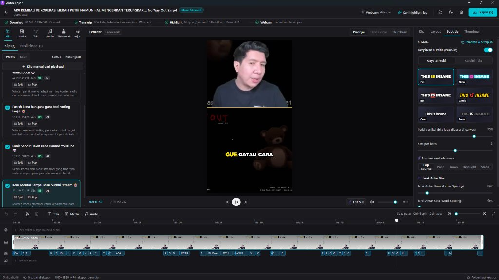
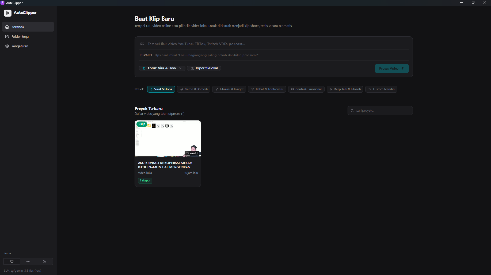

# AutoClipper (Windows)

Aplikasi desktop Windows bertenaga AI untuk memotong video panjang (YouTube, Twitch VOD, podcast, file lokal) menjadi klip vertikal 9:16 siap posting untuk TikTok, Instagram Reels, dan YouTube Shorts, lengkap dengan editor manual ala CapCut.



**Alur Kerja:**
Tempel Link / File Lokal & Pilih Prompt → 1. Download → 2. Transkrip → 3. Highlight AI → 4. Webcam/Facecam → Edit Klip & Subtitle → Ekspor.

---

## Tampilan Antarmuka

| Halaman Beranda & Pemilihan Preset | Editor Klip, Subtitle & Timeline |
|---|---|
|  |  |

---

## Fitur Utama

### 1. AI Prompting & Template Klip (Baru ✨)
- **Preset Tema Fokus Klip**:
  - **Viral & Hook**: Mengutamakan hook 3 detik pertama berenergi tinggi dan retensi maksimal.
  - **Meme & Komedi**: Mencari momen lucu, roasting, blunder, dan bahan meme potensial.
  - **Edukasi & Insight**: Tips praktis, fakta baru, dan insight bernilai tinggi.
  - **Debat & Kontroversi**: Perdebatan sengit, argumen panas, dan pembahasan yang memicu komentar penonton.
  - **Cerita & Emosional**: Kisah dramatis, perjuangan, momen haru, atau motivasi inspiratif.
  - **Deep Talk & Filosofi**: Obrolan mendalam tentang makna hidup, refleksi, dan podcast emas.
  - **Kustom Mandiri**: Ketik instruksi bebas sesuai keinginan (misal: *"Cari saat mereka membahas strategi investasi saham"*).
- **Prompt Tambahan**: Tambahkan instruksi spesifik kapan saja sebelum video diproses.
- **Cari Highlight Ulang**: Buka modal "Cari highlight lagi" di dalam editor untuk menganalisa ulang video dengan template atau prompt berbeda tanpa perlu download ulang.

### 2. Tipografi Subtitle & Animasi Suara (Baru ✨)
- **Animasi Suara (Voice-Triggered Animations)**:
  - Subtitle bergerak dinamis mengikuti artikulasi suara pembicara: **Pop Bounce**, **Pulse**, **Jump**, **Highlight**, dan **Statis**.
- **Kontrol Tipografi Presisi**:
  - Pengaturan **Jarak Antar Huruf** (*Letter Spacing*), **Jarak Antar Kata** (*Word Spacing*), dan **Tinggi Baris** (*Line Height*).
- **Preset Gaya Subtitle Populer**:
  - 6 gaya animasi per kata ala kreator top: **Pop, Neon, Box, Comic, Clean, Focus**.
  - Posisi vertikal slider (bisa juga digeser langsung di canvas) serta jumlah kata per baris.

### 3. Transkripsi Multi-Provider & Model Gemini Terbaru
- **Dukungan Model Gemini Terbaru**: Menggunakan model `gemini-3.8-flash` untuk performa transkrip dan analisa highlight tercepat dan stabil.
- **Provider STT Fleksibel**:
  - **Groq Whisper** (gratis, sangat cepat)
  - **Gemini Audio STT**
  - **OpenAI Whisper**
  - **9Router / Custom STT**
  - **Caption Bawaan YouTube** (tanpa butuh API key)

### 4. Layout Video Otomatis & Cerdas
- **Split**: Menampilkan wajah/webcam di atas dan gameplay/layar di bawah (tandai area webcam secara manual/otomatis).
- **Fill**: Crop vertikal penuh dengan titik fokus horizontal (Focus X).
- **Fit**: Menampilkan seluruh frame asli dengan latar belakang blur (*blurred backdrop*).

### 5. Editor Manual Lengkap (Ala CapCut)
- **Multi-track Timeline**:
  - Pemotongan cepat dengan shortcut (Ctrl+B untuk split, Del untuk hapus, Ctrl+Z / Ctrl+Y untuk Undo/Redo).
  - Trim awal/akhir klip langsung dari timeline.
- **Scene Tambahan**: Sisipkan video intro/outro/b-roll atau gambar di posisi playhead.
- **Teks & Stiker Overlay**: 9 preset gaya teks, font, warna, outline, rotasi, opasitas, dan stiker/logo yang bisa diatur waktu tampilnya.
- **Watermark & Audio**: Tambahkan watermark logo/teks serta musik latar dengan kontrol volume mandiri dan auto-looping.

### 6. Ekspor Berkualitas Tinggi & Cepat
- Ekspor berurutan 1080×1920 H.264 MP4.
- Akselerasi hardware otomatis (NVIDIA NVENC, Intel QSV, AMD AMF) dengan fallback ke CPU (x264).
- Menghasilkan file teks `.txt` yang berisi judul dan deskripsi klip siap copy-paste ke media sosial.

---

## Panduan Instalasi (Pengguna)

1. Jalankan installer `AutoClipper-Setup-*.exe` → Ikuti langkah pemasangan (tidak butuh hak admin).
   - Jika muncul peringatan *Windows protected your PC* (SmartScreen): klik **More info → Run anyway**.
2. Buka AutoClipper → Masuk ke **Pengaturan → AI / API Key**.
3. Masukkan API key gratis pilihan Anda:
   - **Groq API key** (dapatkan gratis di [console.groq.com/keys](https://console.groq.com/keys))
   - atau **Google Gemini API key** (di [aistudio.google.com](https://aistudio.google.com))
4. Klik **Tes koneksi** lalu **Simpan**.
5. Di halaman Beranda, tempel link video (YouTube/TikTok/dsb.) atau impor video lokal, pilih template fokus klip, lalu klik **Proses Video**.

> **Tips:** `ffmpeg` dan `yt-dlp` sudah dibundel langsung dalam aplikasi. Jika terjadi masalah download dari YouTube, buka **Pengaturan → Sistem → Update yt-dlp** atau masukkan Cookies browser Anda di tab Sistem.

---

## Lokasi File & Penyimpanan
- **Folder Project & Hasil Render:** `Dokumen\AutoClipper\projects\<id>\renders\` (dapat diubah di Pengaturan → Render).
- **Pengaturan Aplikasi:** `%APPDATA%\AutoClipper\settings.json`.

---

## Build dari Source (Pengembang)

```bat
npm install
npm run fetch-bins     :: Download yt-dlp.exe & ffmpeg ke resources\bin-win
npm run start          :: Jalankan dalam mode development (Electron + Vite)
npm run dist:win       :: Buat installer Windows di folder release\
```

**Tech Stack:** Electron 38, React 18, Vite, Tailwind CSS, Lucide Icons, ffmpeg, libass, yt-dlp.
